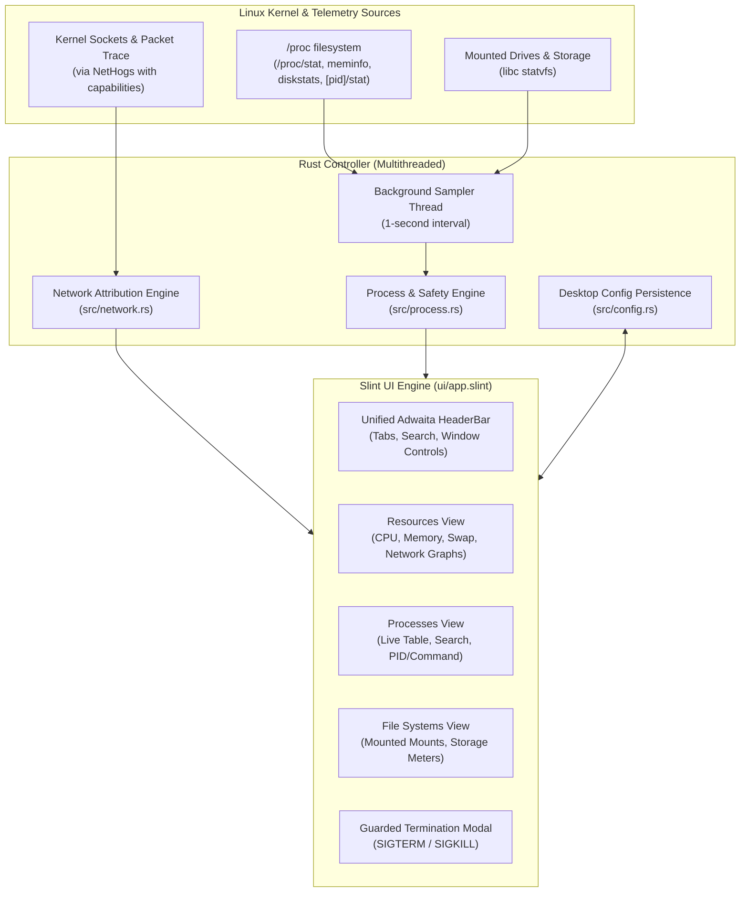
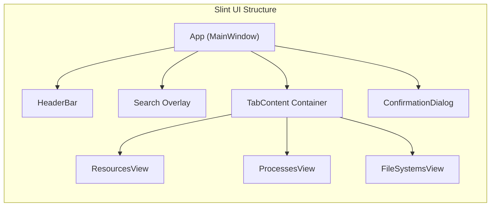
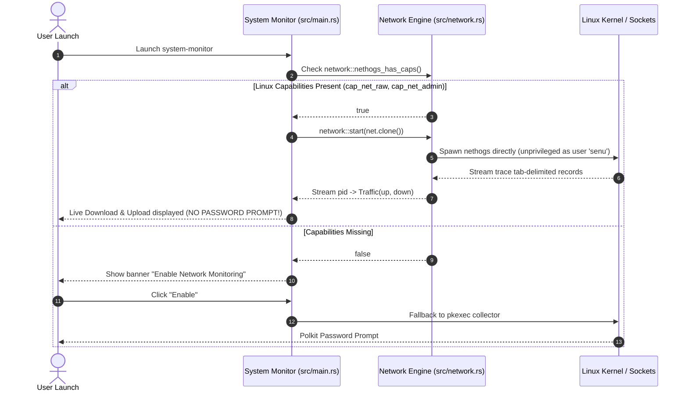

# System Monitor: Architecture & Implementation Guide

This document provides a comprehensive overview of **what** was built in the Linux System Monitor and **how** each system was engineered, from declarative Slint UI styling to low-level Linux kernel telemetry and passwordless network monitoring.

---

## 1. Executive Summary

The application has been transformed into a modern, native Linux desktop system monitor inspired by the modern GNOME Adwaita design language. It combines lightweight Rust systems programming with the Slint declarative UI toolkit to deliver smooth real-time telemetry, safe process controls via Linux `pidfd`, persistent desktop window memory, and seamless, passwordless per-process network attribution.



---

## 2. What We Built ("What We Done")

### 2.1 Modern GNOME Adwaita Dark Theme & Unified Header Bar
- **Single-Line Header Bar**: Unified header containing the window title, expandable search icon, segmented pill navigation tabs (`Resources`, `Processes`, `File Systems`), burger menu, and window action buttons (`_`, `□`, `✕`).
- **Exact Vertical & Horizontal Centering**: Fixed layout alignments, padding, and flex properties so no elements wrap into multiple lines or produce duplicated control buttons.
- **Segmented Pill Tab Switcher**: Dark slate pill bar with active tab highlighting and custom vector icons matching GNOME System Monitor.
- **Full-Width Graph Canvases**: Removed artificial border margins so historical charts stretch edge-to-edge across the card container.

### 2.2 Telemetry & Visualizations (Resources Tab)
- **Multi-Core CPU History**:
  - Dynamically samples each CPU core independently (cores 1 through 8).
  - Plots 60-second real-time historical polyline graphs with distinctive color swatches (red, blue, yellow, green, purple, orange, etc.).
  - Displays instant core utilization percentages alongside interactive legend toggles.
- **Memory & Swap Monitoring**:
  - Donut/Circular gauge visualizer displaying live memory utilization percentage.
  - 60-second historical area/line chart for RAM and Swap.
  - Detailed memory metrics: used bytes, total capacity, and percentage.
- **Network History Graphs**:
  - Combined or separate download and upload rate visualizers.
  - Live throughput tracking with auto-scaling units (B/s, KiB/s, MiB/s, GiB/s).

### 2.3 Process Management & Inspection (Processes Tab)
- **Live Process Table**:
  - Displays Process Name, PID, User, CPU %, Memory (RSS), Disk Read rate, Disk Write rate, Download rate, and Upload rate.
  - Clickable column headers for two-way sorting (ascending/descending) with visible sort indicator arrows.
- **Search & Filter**:
  - Search bar that filters by process name, PID, parent PID, or command-line arguments.
  - Quick filter toggle for active network processes only.
- **Process Inspection & Identity Guarding**:
  - Bottom panel displays selected process command line, binary path, and parent hierarchy.
  - **End Process (SIGTERM)** and **Force Quit (SIGKILL)** with in-app confirmation modal.
  - Protected system critical processes (PID 1, root processes, and the monitor application itself).

### 2.4 Storage & Drive Partitions (File Systems Tab)
- **Mount Point Explorer**:
  - Lists physical storage devices, mount points, filesystem types (ext4, btrfs, tmpfs, etc.).
  - Displays Total, Available, and Used space with visual capacity progress bars.

### 2.5 Desktop Window State Persistence
- **Settings Store (`~/.config/system-monitor/settings.json`)**:
  - Automatically remembers the last window width and height when resized.
  - Restores maximized window state.
  - Remembers the user's last selected tab so reopening the app returns directly to that view.
  - Sensible compact default launch size: `1024px × 680px` (min `760px × 480px`).

### 2.6 Seamless Passwordless Network Telemetry
- **Eliminated Polkit Password Prompts**: Solved the repetitive desktop authorization dialogs when reading per-process network traffic.
- **Linux Capabilities Support**: Native detection of POSIX capabilities on `/usr/bin/nethogs`, allowing unprivileged telemetry extraction.
- **Auto-Start on Startup**: Immediately streams live per-process Download and Upload bandwidth as soon as the app opens.
- **Polkit Automation Fallback**: Provided a system-level policy rule for environments using `pkexec`.
- **One-Step Setup Script**: Automated installation and configuration via `scripts/setup-passwordless.sh`.

---

## 3. How We Built It ("How We Done")

### 3.1 Declarative UI Architecture (`ui/app.slint`)
The user interface is declared in Slint's domain-specific language and compiled to native Rust code at build time.



- **HeaderBar & Navigation**:
  Using `HorizontalLayout` with `alignment: center` and nested flex elements to ensure the search trigger, central tabs, and window controls remain on a single line regardless of window width.
- **Vector Path Generators**:
  Custom Rust helper functions (`generate_history_path`, `generate_donut_path`) in `src/lib.rs` convert 60-second telemetry rings into SVG path strings (`M x y L x y ...`) bound directly to Slint `Path` components for zero-overhead vector rendering.

### 3.2 Kernel Sampling & Process Engine (`src/process.rs`)
Data collection runs on an isolated background thread to guarantee the UI thread maintains 60 FPS without stutter.

1. **CPU Usage**:
   Reads `/proc/stat` to calculate jiffies spent in user, nice, system, idle, and iowait. Difference between consecutive samples gives accurate percentage:
   $$\text{Usage} = \frac{\Delta \text{work}}{\Delta \text{total}} \times 100$$
2. **Process List**:
   Iterates `/proc/[pid]/stat`, `/proc/[pid]/status`, and `/proc/[pid]/io`.
   - Caches static metadata (binary path, command line, start time) to avoid disk read overhead every cycle.
   - Computes delta I/O for per-process disk read and write throughput.
3. **Safe Termination via `pidfd`**:
   To prevent killing the wrong process if a PID is recycled between selection and button click:
   ```rust
   // Uses Linux pidfd_open system call (kernel >= 5.3)
   let pidfd = unsafe { libc::syscall(libc::SYS_pidfd_open, pid, 0) };
   ```
   Checks the process start time against the initial sample time before issuing `pidfd_send_signal`.

### 3.3 Passwordless Network Attribution Engine (`src/network.rs`)

#### The Challenge
Measuring socket-to-process attribution requires reading kernel sockets and `/proc/<pid>/fd/` file descriptors, which standard users cannot access without privilege. Previously, this invoked `pkexec` which displayed an authentication password dialog every session.

#### The Architecture



#### Implementation Details
1. **Capability Detection**:
   ```rust
   pub fn nethogs_has_caps() -> bool {
       let path = match nethogs_path() { Some(p) => p, None => return false };
       if let Ok(output) = Command::new("getcap").arg(path).output() {
           let text = String::from_utf8_lossy(&output.stdout);
           return text.contains("cap_net_raw") || text.contains("cap_net_admin");
       }
       false
   }
   ```
2. **Direct Execution Without Root**:
   If capabilities are found, `network::start` executes `/usr/bin/nethogs -t -d 1 -v 0` as the current user without `pkexec` or `sudo`.
3. **Trace Parser**:
   Parses NetHogs standard output in real time:
   `[program_name]/[pid]/[uid]\t[upload_kb_s]\t[download_kb_s]`
   Accumulates delta throughput per PID, discards stale samples older than 4 seconds, and sends metrics to the UI model.

### 3.4 Automated Setup Script (`scripts/setup-passwordless.sh`)
To make setup a one-click process for any Linux user, the shell script executes:
1. `setcap "cap_net_admin,cap_net_raw,cap_dac_read_search,cap_sys_ptrace+ep" /usr/bin/nethogs`
2. Creates `/etc/polkit-1/rules.d/50-system-monitor.rules` as a seamless fallback.

### 3.5 Desktop Preferences & Window Memory (`src/config.rs`)
- Uses `serde` and `serde_json` to manage `Settings`:
  ```rust
  #[derive(Clone, Debug, Serialize, Deserialize)]
  pub struct Settings {
      pub width: u32,
      pub height: u32,
      pub maximized: bool,
      pub last_tab: i32,
  }
  ```
- Stored at standard XDG path: `~/.config/system-monitor/settings.json`.
- Uses atomic write pattern (`write to .tmp` then `rename`) to prevent file corruption during sudden termination.

---

## 4. Verification and Test Suite

All changes are validated with automated test suites:

| Test Name | Module | Purpose |
|---|---|---|
| `save_and_load_roundtrip` | `config` | Validates configuration persistence to disk |
| `parse_and_serialize_roundtrip` | `config` | Ensures JSON settings parse properly |
| `reject_bad_samples` | `network` | Validates rejection of malformed network rows |
| `paths_and_units` | `network` | Tests KB/s conversion to bytes/sec |
| `stale_is_not_zero` | `network` | Ensures outdated samples show dash instead of 0 |
| `stat_handles_parentheses` | `process` | Handles processes with parentheses in names (e.g. `(Web Content)`) |
| `identity_guard_and_termination`| `process` | Validates `pidfd` lifecycle protection against PID reuse |
| `samples_real_process` | `process` | Verifies `/proc` parsing against live PID |
| `decimal_and_binary_formatting` | `lib` | Checks unit formatting (`KiB`, `MiB`, `GiB`) |
| `path_generation` | `lib` | Validates SVG path string math for graphs |
| `displayed_network_totals_match`| `main` | Regression test verifying summary totals match row sums |
| `render_monitor_and_confirmation`| `ui` | Headless rendering of full UI and confirmation modals |

All 14 tests pass cleanly via `cargo test --locked`.

---

## 5. File Map

- [ui/app.slint](file:///home/senu/PROJECTS/system-monitor/ui/app.slint): Declarative UI layout, theme, header bar, graphs, and tables.
- [src/main.rs](file:///home/senu/PROJECTS/system-monitor/src/main.rs): Application controller, Slint bindings, auto-start logic, and event loops.
- [src/network.rs](file:///home/senu/PROJECTS/system-monitor/src/network.rs): NetHogs process spawning, capability detection, and socket trace parser.
- [src/process.rs](file:///home/senu/PROJECTS/system-monitor/src/process.rs): `/proc` hardware sampler, process tree builder, and `pidfd` termination guard.
- [src/config.rs](file:///home/senu/PROJECTS/system-monitor/src/config.rs): Window size, position, and tab persistence.
- [src/lib.rs](file:///home/senu/PROJECTS/system-monitor/src/lib.rs): Unit formatting and vector SVG path generation.
- [scripts/setup-passwordless.sh](file:///home/senu/PROJECTS/system-monitor/scripts/setup-passwordless.sh): One-step configuration script for capabilities and Polkit.
- [bin/system-monitor](file:///home/senu/PROJECTS/system-monitor/bin/system-monitor): Compiled release binary.
